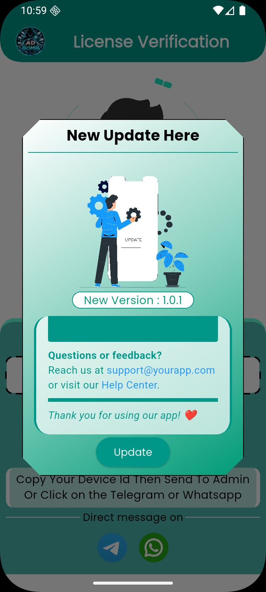

# ⚡ AD BOMB

### NEXT-GEN • FUTURISTIC • BUILT TO STAND OUT

**A bold, modern Android app experience.**

[](#)
[](#)
[](#)


------------------------------------------------------------------------

## 🚀 About AD BOMB

**AD BOMB** is an Android application project built with a futuristic
visual identity, electric-cyan accents, and a dark interface direction.

This repository is the home for the project's source code, releases, and
development updates.

> **Project vision:** A sharp, fast, and polished app experience with
> the AD BOMB identity at its core.

## ✨ Highlights

-   **Distinctive identity** --- custom AD BOMB branding and logo.
-   **Modern Android experience** --- designed for mobile-first use.
-   **Release updates** --- app builds can be published through GitHub
    Releases.
-   **Continuous improvements** --- features and fixes can be documented
    with every release.

```{=html}
<!--
Add only features that are already implemented in your app.
Suggested format:
- Feature name — short explanation.
-->
```
## 🧰 Tech Stack

Update this section to match the exact technologies used by your
project.

  Area                   Technology
  ---------------------- -----------------
  App framework          Flutter
  Language               Dart
  Source hosting         GitHub
  Release distribution   GitHub Releases

## 📦 Download

Get the latest available build from the repository's **Releases** page:

➡️ **[View AD BOMB Releases](../../releases)**

Download the APK asset attached to the latest release. Only install
builds published by the official project owner.

## 🛠️ Run Locally

1.  Install [Flutter](https://docs.flutter.dev/get-started/install) and
    the Android development toolchain.

2.  Clone this repository:

    ``` bash
    git clone https://github.com/YOUR-USERNAME/YOUR-REPOSITORY.git
    ```

3.  Open the project folder:

    ``` bash
    cd YOUR-REPOSITORY
    ```

4.  Install dependencies:

    ``` bash
    flutter pub get
    ```

5.  Run the app:

    ``` bash
    flutter run
    ```

## 🏗️ Build Release APK

``` bash
flutter build apk --release
```

The generated APK is usually available at:

``` text
build/app/outputs/flutter-apk/app-release.apk
```

Before publishing a new release, update the app version in
`pubspec.yaml`, build the APK, and attach it to a new GitHub Release.

## 🗺️ Roadmap

-   [ ] Complete project documentation
-   [ ] Publish stable Android releases
-   [ ] Document implemented features
-   [ ] Add screenshots and demo media
-   [ ] Maintain a release changelog

## 📸 Screenshots

Screenshots will be added here as the app UI is ready.

| Dashboard | Settings |
|-----------|----------|
|  |  |
## 📝 Changelog

See [GitHub Releases](../../releases) for version history and release
notes.

## 🤝 Contributions

Suggestions, bug reports, and improvements are welcome. Please open an
issue with clear steps and relevant screenshots or logs.

## ⚠️ Disclaimer

This repository is provided for its stated development and distribution
purpose. Use the application responsibly and only with systems,
accounts, and data you are authorized to access.

## 📬 Contact

For support or project-related queries, open a GitHub issue in this
repository.

------------------------------------------------------------------------

